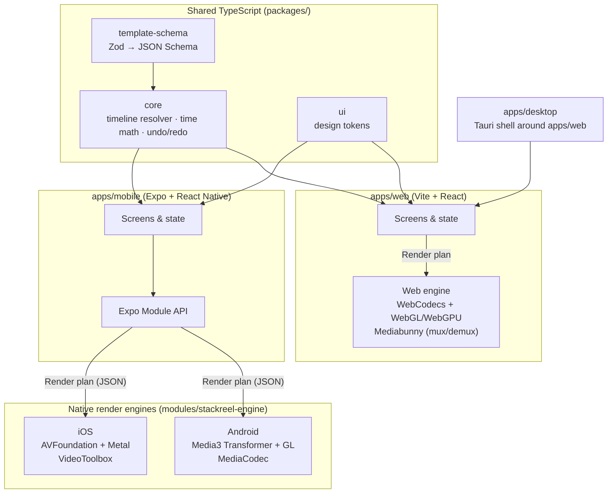

<div align="center">

# StackReel

**Stack your clips. Ship your reel.**

A free, open-source, on-device editor for vertical video (Reels, TikTok, YouTube Shorts).
Pick a template, drop in your clips, and export. Your media never leaves your device.

`iOS` · `Android` · `Web` · `Desktop` · MIT licensed

**Status:** 🧱 Phase 0, Foundations. Nothing is usable yet. This README is the plan.

</div>

---

## Table of contents

1. [Vision](#vision)
2. [Product principles](#product-principles)
3. [Non-goals (for now)](#non-goals-for-now)
4. [Architecture overview](#architecture-overview)
5. [Tech stack](#tech-stack)
6. [Repository layout](#repository-layout)
7. [The StackReel Template Format](#the-stackreel-template-format)
8. [Roadmap at a glance](#roadmap-at-a-glance)
9. [Detailed roadmap, step by step](#detailed-roadmap-step-by-step)
   - [Phase 0: Foundations](#phase-0-foundations)
   - [Phase 1: Template format & core model](#phase-1-template-format--core-model)
   - [Phase 2: iOS render engine](#phase-2-ios-render-engine)
   - [Phase 3: Android render engine](#phase-3-android-render-engine)
   - [Phase 4: Mobile app MVP](#phase-4-mobile-app-mvp)
   - [Phase 5: Performance system (proxies, preview tiers, caching)](#phase-5-performance-system-proxies-preview-tiers-caching)
   - [Phase 6: On-device auto-captions](#phase-6-on-device-auto-captions)
   - [Phase 7: Beta & store launch (v1.0)](#phase-7-beta--store-launch-v10)
   - [Phase 8: Web app](#phase-8-web-app)
   - [Phase 9: Desktop app](#phase-9-desktop-app)
   - [Phase 10: Pro mode (timeline, keyframes, 4K)](#phase-10-pro-mode-timeline-keyframes-4k)
   - [Phase 11: Community templates & plugins](#phase-11-community-templates--plugins)
10. [Testing strategy](#testing-strategy)
11. [Performance budgets](#performance-budgets)
12. [Risks & mitigations](#risks--mitigations)
13. [Getting started (developers)](#getting-started-developers)
14. [Contributing](#contributing)
15. [License](#license)

---

## Vision

Most people who make short-form video edit **on their phone**, want a **good-looking result in under five minutes**,
and don't want a subscription or a watermark. Existing free editors either lock features behind paywalls,
upload your footage to their servers, or bury simple tasks under a pro-editor timeline.

StackReel is built around one idea: **a video is a stack of layers described by a template.**
Users fill the template's slots with their own clips, tweak the text, choose music, and export.
Power users can open the same project in Pro mode and edit every layer on a full timeline.

## Product principles

1. **Template-first.** The default flow is _pick → fill → tweak → export_. A timeline is optional.
2. **Vertical-native.** 9:16 at 1080×1920 is the default canvas. Safe zones for TikTok, Reels, and Shorts UI are always visible.
3. **On-device and private.** No uploads, no account required, no analytics without opt-in.
4. **Hardware-accelerated.** Every platform uses its native GPU and hardware codecs. We never write our own codecs.
5. **One format, many engines.** A single JSON template format renders identically on iOS, Android, Web, and Desktop.
6. **Free forever, no watermark.** MIT licensed.

## Non-goals (for now)

- Cloud rendering, cloud storage, or accounts
- Horizontal or long-form editing (16:9 export may come later, but it is not a design target)
- Generating video from text prompts (text-to-video)
- Collaboration and multi-user editing
- Hand-written codecs or containers. We use platform APIs and well-maintained libraries.

---

## Architecture overview



**How a video gets made:**

1. A **template** (JSON) defines the canvas, slots, tracks, text, transitions, and music.
2. The user fills the slots, which produces a **project**: the template plus asset bindings and edits.
3. `@stackreel/core` **resolves** the project into a flat **render plan**: every layer with absolute times, transforms, and effects.
4. A **platform engine** turns the render plan into preview frames in real time, then into an encoded MP4 on export.
5. **Golden-frame tests** check that every engine produces visually equivalent output for the same plan.

---

## Tech stack

| Layer             | Choice                                                                                                               | Why                                                                           |
| ----------------- | -------------------------------------------------------------------------------------------------------------------- | ----------------------------------------------------------------------------- |
| Monorepo          | **pnpm workspaces + Turborepo**                                                                                      | Fast, simple, works well with Expo and Vite                                   |
| Language (shared) | **TypeScript** (strict)                                                                                              | Team strength. One language for UI and core logic.                            |
| Schema            | **Zod**, exported to **JSON Schema**                                                                                 | Runtime validation in TS. Codegen for Swift and Kotlin.                       |
| Mobile UI         | **Expo (React Native)**, Expo Router, Reanimated, Gesture Handler                                                    | One UI codebase for iOS and Android, native-quality gestures                  |
| Mobile state      | **Zustand** + **Immer**                                                                                              | Small and predictable, fits undo/redo                                         |
| Mobile storage    | **expo-sqlite** + app sandbox files                                                                                  | Offline project library                                                       |
| iOS engine        | **Swift**, AVFoundation (`AVMutableComposition`, custom `AVVideoCompositing`), **Metal**, Core Text, VideoToolbox    | Hardware decode and encode, GPU compositing                                   |
| Android engine    | **Kotlin**, **AndroidX Media3** (`Transformer`, `Composition`, `CompositionPlayer`, `Effect`), OpenGL ES, MediaCodec | Google's supported path for on-device editing                                 |
| Native bridge     | **Expo Modules API** (Swift and Kotlin)                                                                              | Typed, modern, no hand-written JSI                                            |
| Web UI            | **Vite + React**                                                                                                     | Fast dev loop, shares components and logic with mobile                        |
| Web engine        | **WebCodecs**, **WebGL2 → WebGPU**, **Mediabunny** (demux/mux), Web Workers, OPFS                                    | Hardware codecs in the browser, off-main-thread rendering, local file storage |
| Desktop           | **Tauri 2**                                                                                                          | Small binaries. Reuses `apps/web`. Rust side available for native file I/O.   |
| Captions (ASR)    | **WhisperKit** (iOS), **whisper.cpp** (Android, Web via WASM)                                                        | On-device speech-to-text                                                      |
| Testing           | Vitest, Jest (RN), XCTest, JUnit/Robolectric, Playwright, golden-frame diffing                                       | See [Testing strategy](#testing-strategy)                                     |
| CI                | GitHub Actions (+ EAS Build for mobile binaries)                                                                     | Standard and free for open source                                             |
| Crash reporting   | Opt-in only, self-hostable (e.g. Sentry or GlitchTip)                                                                | Privacy principle                                                             |

---

## Repository layout

```
StackReel/
├── apps/
│   ├── mobile/            # Expo app (iOS + Android)
│   ├── web/               # Vite + React browser app
│   └── desktop/           # Tauri shell around apps/web
├── packages/
│   ├── template-schema/   # The template format: Zod schema, JSON Schema, migrations
│   ├── core/              # Timeline resolver, time math, undo/redo, project model
│   └── ui/                # Design tokens & shared primitives
├── modules/
│   └── stackreel-engine/  # Expo native module: ios/ (Swift+Metal), android/ (Kotlin+Media3)
├── templates/
│   └── examples/          # Built-in templates (JSON + preview thumbnails)
├── docs/
│   └── adr/               # Architecture Decision Records
├── .github/               # Issue & PR templates, CI workflows
├── package.json
└── pnpm-workspace.yaml
```

---

## The StackReel Template Format

The template format is the **most important design decision in the project**. Every engine renders it, and every
feature (text, transitions, captions, music) is expressed in it.

**Rules:**

- **Time is integer microseconds** (`startUs`, `durationUs`). There are no floats for time. Media3 uses µs natively, and iOS converts to `CMTime(value:timescale: 1_000_000)`.
- **Positions are normalized** (0–1 relative to the canvas), so templates scale from 720p to 4K.
- **Slots** are placeholders that the user fills (`video`, `image`, `audio`, `text`).
- **Tracks** are ordered bottom to top. `video` tracks hold media. `overlay` tracks hold text, stickers, and shapes.
- **`schemaVersion`** is required. Breaking changes ship with a migration in `packages/template-schema/src/migrate.ts`.

Full example: [`templates/examples/hook-and-reveal.json`](templates/examples/hook-and-reveal.json)

```jsonc
{
  "schemaVersion": 1,
  "id": "hook-and-reveal",
  "canvas": { "width": 1080, "height": 1920, "fps": 30 },
  "durationUs": 9000000,
  "slots": [{ "id": "clip1", "kind": "video", "label": "Your hook shot" }],
  "tracks": [
    {
      "id": "main",
      "type": "video",
      "items": [{ "slot": "clip1", "startUs": 0, "durationUs": 3000000, "fit": "cover" }],
    },
    {
      "id": "text",
      "type": "overlay",
      "items": [
        {
          "kind": "text",
          "startUs": 200000,
          "durationUs": 2600000,
          "text": { "default": "Wait for it…", "editable": true },
          "animation": { "in": "pop", "out": "fade" },
        },
      ],
    },
  ],
}
```

---

## Roadmap at a glance

Estimates assume a **small team (2–5 people)** working part-time to full-time. Phases overlap where noted.

| Phase | Name                          | Est. duration | Depends on            | Ships                                     |
| ----- | ----------------------------- | ------------- | --------------------- | ----------------------------------------- |
| 0     | Foundations                   | 1–2 weeks     |                       | Repo, tooling, CI, design basics          |
| 1     | Template format & core model  | 3–4 weeks     | 0                     | `template-schema` v1, `core` resolver     |
| 2     | iOS render engine             | 5–6 weeks     | 1                     | Preview and export on iPhone              |
| 3     | Android render engine         | 5–6 weeks     | 1 (parallel with 2)   | Preview and export on Android             |
| 4     | Mobile app MVP                | 6 weeks       | 2, 3                  | Internal alpha: full template flow        |
| 5     | Performance system            | 3–4 weeks     | 4                     | Proxies, preview tiers, caching           |
| 6     | On-device auto-captions       | 3–4 weeks     | 4                     | Animated captions from speech             |
| 7     | Beta & store launch           | 3–4 weeks     | 5, 6                  | **v1.0 on App Store & Google Play**       |
| 8     | Web app                       | 6–8 weeks     | 1 (can start after 4) | Browser editor                            |
| 9     | Desktop app                   | 2–3 weeks     | 8                     | macOS / Windows / Linux builds            |
| 10    | Pro mode                      | 8+ weeks      | 7                     | Multi-track timeline, keyframes, 4K tiers |
| 11    | Community templates & plugins | ongoing       | 7                     | Template sharing, plugin API              |

**Milestones**

- 🟢 **M1, "First frame"** (end of Phase 2/3): a hard-coded template renders to MP4 on both phones.
- 🟢 **M2, "Internal alpha"** (end of Phase 4): the team uses StackReel to make real reels.
- 🟢 **M3, "v1.0 public"** (end of Phase 7): live on both app stores.
- 🟢 **M4, "Everywhere"** (end of Phase 9): web and desktop.
- 🟢 **M5, "Pro"** (Phase 10): full timeline editing.

---

## Detailed roadmap, step by step

Each phase lists a **goal**, **numbered steps**, **deliverables**, and **exit criteria**.
A phase is done only when every exit criterion is met.

---

### Phase 0: Foundations

**Goal:** A clean, automated repo that any contributor can clone and run in under 15 minutes.

**Steps**

1. **Repo & governance**
   - [x] Create the GitHub repo `StackReel`, MIT license, README roadmap
   - [x] Add `CONTRIBUTING.md`, issue and PR templates
   - [x] Write ADR 0001 (build from scratch rather than fork OpenCut)
   - [ ] Enable branch protection on `main`: require PR, 1 review, passing CI, linear history
   - [ ] Create GitHub Project board with columns _Backlog → Ready → In progress → Review → Done_
   - [ ] Create labels: `phase:0`…`phase:11`, `area:schema`, `area:ios`, `area:android`, `area:web`, `area:ui`, `good first issue`
   - [ ] Turn every unchecked step in this README into an issue linked to its phase
   - [x] Add the **status rule** automation: `/claim` and `/unclaim` on issues, overlapping-PR warnings, stale-claim release (see [CONTRIBUTING.md](CONTRIBUTING.md#status-rule-claim-work-before-starting))
   - [ ] Create the `status: in progress` label (the claim bot also adds it automatically)
2. **Toolchain**
   - [x] Pin Node 22 LTS (`.nvmrc`) and pnpm 9 (`packageManager` field, Corepack)
   - [x] Add Turborepo with `build`, `dev`, `lint`, `test`, `typecheck` pipelines
   - [x] Shared `tsconfig.base.json` (strict, `noUncheckedIndexedAccess`, `exactOptionalPropertyTypes`)
   - [x] ESLint (flat config) + Prettier
   - [ ] SwiftLint and ktlint for the native code (lands with Phases 2 and 3)
   - [x] Husky + lint-staged pre-commit hook. Add commitlint for Conventional Commits.
3. **CI (GitHub Actions)**
   - [x] `ci.yml`: install → lint → typecheck → unit tests on every PR
   - [x] Cache the pnpm store and Turborepo outputs
   - [ ] macOS runner job for iOS build and test (added in Phase 2)
   - [ ] Ubuntu job for Android build and test (added in Phase 3)
4. **Release tooling**
   - [x] Changesets for versioning packages and the changelog
   - [ ] Expo EAS account (free tier) for mobile builds
5. **Legal & identity**
   - [ ] Reserve the **StackReel** name in App Store Connect (create the app record) and the Google Play Console
   - [ ] Run a trademark search (USPTO / WIPO) for "StackReel" in class 9 (software)
   - [ ] Register a domain (e.g. `stackreel.app` or `getstackreel.com`)
   - [ ] Draft a privacy policy: "no data collected" plus the opt-in crash reporting clause
6. **Design basics**
   - [ ] Figma file with user flows: _Home → Template gallery → Fill slots → Preview/Tweak → Export → Share_
   - [x] Design tokens (color, type scale, spacing, radii, motion durations) in `packages/ui`
   - [ ] App icon and wordmark v0
   - [x] Safe-zone overlays for TikTok, Reels, and Shorts (top and bottom UI, right-side buttons)

**Deliverables:** working monorepo, green CI, project board, name reserved.

**Exit criteria**

- `pnpm install && pnpm test` passes on a fresh clone (macOS, Linux, Windows)
- CI runs on every PR in under 5 minutes
- Every Phase 1 step has an issue

---

### Phase 1: Template format & core model

**Goal:** Define the template format and the logic that turns _template + user clips_ into a _render plan_.
This phase has no video code. It is pure, fully tested TypeScript.

**Steps**

1. **Write the spec first**
   - [ ] `docs/template-format.md`: every field, its units, defaults, and an example
   - [ ] Decide the v1 feature set: video, image, and audio slots; text overlays; 6–8 transitions (cut, crossfade, whip-pan, zoom-punch, slide, spin); 8–10 text animations; fit modes (`cover`, `contain`, `fill`); speed (0.25×–4×); volume and fades; music with ducking
   - [ ] Write ADR 0002: _integer microseconds for all time values_
   - [ ] Write ADR 0003: _normalized coordinates and anchor points_
2. **Implement `@stackreel/template-schema`**
   - [x] Zod schema for `Template`, `Slot`, `Track`, `Item` (`MediaItem`, `TextItem`, `StickerItem`), `Transition`, `Animation`, `Style`
   - [x] Strong types exported via `z.infer`
   - [x] Generate `stackreel-template.v1.json` (JSON Schema) at build time with Zod's built-in `z.toJSONSchema`
   - [x] `validate(json)`: returns typed errors with JSON paths for the UI
   - [x] `migrate(json)`: no-op for v1, but the pipeline and tests exist from day one
3. **Implement `@stackreel/core`**
   - [x] `Project` model: `template` + `bindings` (slot → asset URI, trim in and out, crop) + `overrides` (text edits, style tweaks)
   - [x] **Slot fitting:** when a user clip is longer than the slot, pick the best trim window (default: start, later "smart" via motion and faces). If it's shorter, freeze the last frame or slow it down, as the template's `shortClipPolicy` says.
   - [x] **Resolver:** `resolve(project) → RenderPlan`, a flat, time-sorted list of layers with absolute `startUs`/`endUs`, source time ranges, transform matrices, opacity, effects, and transition pairs
   - [x] **Time utilities:** frame-snapping (`usToFrame`, `frameToUs` for 24/25/30/60 fps), range math
   - [x] **Command stack:** undo/redo with Immer patches. Every edit is a command (`ReplaceSlotAsset`, `EditText`, `SetTrim`, …).
   - [x] **Serialization:** save and load projects as JSON with `schemaVersion`
4. **Sample templates**
   - [x] Create 10 built-in templates in `templates/examples/` covering every v1 feature
   - [ ] Each template ships with a `.thumb.jpg` and a short `.preview.mp4` (generated in Phase 4)
5. **Testing**
   - [x] Unit tests for every schema rule (valid and invalid fixtures)
   - [x] Property-based tests (fast-check) for the resolver: no negative durations, layers stay in bounds, transitions never overlap more than two clips
   - [x] Snapshot tests: the render plan for each sample template
   - [x] Export `fixtures/` so Swift and Kotlin tests use **the exact same JSON**

**Deliverables:** `@stackreel/template-schema@0.1.0`, `@stackreel/core@0.1.0`, 10 templates, spec doc.

**Exit criteria**

- 100% of sample templates validate and resolve
- At least 90% line coverage on `core` and `template-schema`
- JSON Schema is published as a build artifact for the native teams

---

### Phase 2: iOS render engine

**Goal:** Given a render plan, play a real-time preview and export an H.264 or HEVC MP4 on iPhone, fully hardware-accelerated.
_Runs in parallel with Phase 3._

**Steps**

1. **Module scaffold**
   - [ ] Create an Expo module in `modules/stackreel-engine` (`npx create-expo-module --local`)
   - [ ] Swift package layout: `Plan/` (Codable models generated from JSON Schema), `Composition/`, `Compositor/`, `Text/`, `Export/`, `Preview/`
   - [ ] Generate Swift `Codable` types from `stackreel-template.v1.json` (quicktype) and check them in CI
2. **Composition builder**
   - [ ] Map the render plan to `AVMutableComposition`: insert each clip's source range on alternating A/B video tracks so transitions can overlap
   - [ ] Audio: `AVMutableAudioMix` with volume ramps for fades and ducking
   - [ ] Speed changes via `scaleTimeRange`
   - [ ] Handle rotation and `preferredTransform` for portrait iPhone footage (a common bug source)
3. **Metal compositor**
   - [ ] Implement `AVVideoCompositing` with a custom `AVVideoCompositionInstruction` carrying the layers active in each time range
   - [ ] Metal pipeline: YUV → RGB conversion, per-layer transform (fit/crop/scale/rotate), opacity, blend
   - [ ] Transitions as Metal fragment shaders (crossfade, whip-pan blur, zoom-punch, slide, spin)
   - [ ] Pool `CVPixelBuffer`s and textures. Allocate nothing per frame.
4. **Text & overlays**
   - [ ] Render text to textures with Core Text (stroke, shadow, background pill), cached per text and style
   - [ ] Text animations (pop, fade, typewriter, slide-up, bounce) evaluated per frame in the compositor
   - [ ] Bundle fonts with the app (Inter, Montserrat, Bebas Neue, Poppins, all under the OFL license)
5. **Preview**
   - [ ] `AVPlayer` + `AVPlayerItem` with `videoComposition`, shown in a native `StackReelPreviewView` exposed to React Native
   - [ ] Seek, play, pause, loop, and a current-time event stream to JS
   - [ ] Preview at reduced `renderSize` (see Phase 5) when the device tier requires it
6. **Export**
   - [ ] `AVAssetReader` → compositor → `AVAssetWriter` for full control over bitrate, profile, and color
   - [ ] Presets: 1080×1920 @30 H.264 high (default), HEVC option, 60 fps option
   - [ ] Progress events, cancellation, background-safe temp files
   - [ ] Save to Photos (`PHPhotoLibrary`) and the share sheet
7. **Tests**
   - [ ] XCTest: decode each shared fixture plan, export it, and compare sampled frames to golden PNGs (SSIM ≥ 0.98)
   - [ ] Benchmarks on the oldest supported device (iPhone XS / A12): preview fps and export speed

**Exit criteria (M1, iOS)**

- All 10 sample templates export correctly on iPhone 12 or newer
- Preview holds ≥ 30 fps at 1080p on iPhone 12, with no dropped frames during transitions
- Exporting a 30 s 1080p30 video takes ≤ 15 s on iPhone 12

---

### Phase 3: Android render engine

**Goal:** Same contract as Phase 2, on Android, using AndroidX Media3.

**Steps**

1. **Module scaffold**
   - [ ] Kotlin side of `modules/stackreel-engine`. Packages: `plan`, `composition`, `effects`, `text`, `export`, `preview`.
   - [ ] Generate Kotlin data classes (kotlinx.serialization) from the JSON Schema
   - [ ] `minSdk 26` (Android 8). Target the latest SDK.
2. **Composition builder**
   - [ ] Map the render plan to a Media3 `Composition` → `EditedMediaItemSequence` → `EditedMediaItem` (clipping config, speed via `SpeedChangeEffect`)
   - [ ] Overlapping transitions: a second sequence plus a custom `VideoCompositor` or multi-input GL effect
   - [ ] Audio: `AudioProcessor`s for volume, fades, and ducking. Mix music as a separate sequence.
3. **GL effects**
   - [ ] Custom `GlEffect` / `GlShaderProgram` for fit/crop/transform and each transition, as GLSL ports of the Metal shaders (same math, same golden frames)
   - [ ] HDR → SDR tone-mapping for HDR source clips (common on recent flagships)
4. **Text & overlays**
   - [ ] `OverlayEffect` with `TextOverlay` / `BitmapOverlay`. Render text with `StaticLayout` + `Canvas` and cache bitmaps.
   - [ ] Text animations evaluated per frame (shared animation curves defined in `core`)
5. **Preview**
   - [ ] `CompositionPlayer` (Media3) for real-time preview of the same `Composition`. Fall back to ExoPlayer + effects if needed.
   - [ ] Native `StackReelPreviewView` exposed to React Native with the same props and events as iOS
6. **Export**
   - [ ] Media3 `Transformer` with `MediaCodec` hardware encoders. H.264 default, HEVC when `MediaCodecList` reports support.
   - [ ] Progress, cancellation, and a foreground service for long exports
   - [ ] Save via `MediaStore`. Share via `Intent.ACTION_SEND`.
7. **Device matrix**
   - [ ] Test on at least 6 devices: Pixel (recent and 3-year-old), Samsung flagship and A-series, Xiaomi/Redmi, a low-end Android Go device
   - [ ] Track codec quirks in `docs/android-device-quirks.md`
8. **Tests**
   - [ ] Instrumented tests export each shared fixture and compare golden frames (SSIM ≥ 0.97 vs. iOS goldens)

**Exit criteria (M1, Android)**

- All sample templates export correctly on a Pixel 7-class device and a mid-range Samsung A-series
- Golden frames match iOS within tolerance
- The bridge API is **identical** to iOS (same TS types)

---

### Phase 4: Mobile app MVP

**Goal:** The full user flow, _pick a template → fill → tweak → export → share_, works end to end on both platforms.

**Steps**

1. **App scaffold**
   - [ ] `apps/mobile` with Expo SDK (latest), Expo Router, TypeScript strict, development build (not Expo Go, because we need native modules)
   - [ ] Navigation: tabs _Templates_ / _Projects_ / _Settings_
   - [ ] Theme from `packages/ui` tokens. Dark mode by default.
2. **Template gallery**
   - [ ] Grid of templates with auto-playing muted previews (lazy, at most 2 playing at once)
   - [ ] Categories and filters: _Trending style_, _Travel_, _Food_, _Fitness_, _Talking head_, _Product_
   - [ ] Template detail: preview, slot count, duration, "Use template"
3. **Fill slots**
   - [ ] Media picker (`expo-image-picker` / native picker) with multi-select. Auto-assign clips to slots in order.
   - [ ] Slot strip: tap a slot to replace its clip, long-press to reorder
   - [ ] Trim sheet: scrub a filmstrip and drag a window locked to the slot's duration
   - [ ] Crop and reframe: pinch and drag inside the 9:16 frame, with face-centered auto-reframe as a stretch goal
4. **Preview & tweak**
   - [ ] Full-screen native preview with play/pause and a scrubber
   - [ ] Safe-zone overlay toggle (TikTok / Reels / Shorts)
   - [ ] Edit text: tap text on the preview to edit it inline. Pick a style preset, color, and font.
   - [ ] Music: pick from device files plus a bundled royalty-free starter pack (CC0). Trim the start offset and set volume.
   - [ ] Clip volume and mute. Undo/redo buttons wired to the `core` command stack.
5. **Projects**
   - [ ] Auto-save every edit (debounced) to SQLite and the app sandbox
   - [ ] Project list with thumbnails. Duplicate, rename, delete.
   - [ ] Handle missing media (the user deleted a clip from Photos): show a relink prompt
6. **Export & share**
   - [ ] Export sheet: resolution (720p / 1080p), fps (30/60), quality (standard / high)
   - [ ] Progress screen with cancel. Keep the screen awake during export.
   - [ ] Post-export: save to gallery, share sheet, and quick-share buttons that open TikTok, Instagram, or YouTube via their share intents
7. **Polish**
   - [ ] Haptics on key actions. Skeleton loaders.
   - [ ] Accessibility: Dynamic Type, VoiceOver/TalkBack labels, minimum 44 pt hit targets
   - [ ] Localization scaffold (i18next), English first
   - [ ] Permission flows with clear explanations (Photos, Microphone later for voiceover)
8. **Internal alpha**
   - [ ] EAS internal distribution to the team
   - [ ] Every team member makes and posts 5 real reels and files issues

**Exit criteria (M2)**

- A new user goes from opening the app to an exported reel in **under 3 minutes** without help
- No crashes across 50 consecutive exports on the test devices
- Cold start under 2 s on mid-range devices

---

### Phase 5: Performance system (proxies, preview tiers, caching)

**Goal:** Smooth editing on mid-range phones and with heavy source footage (4K HEVC, 60 fps, HDR). This is the same approach
Premiere and CapCut use.

**Steps**

1. **Device tiering**
   - [ ] On first launch, run a 3-second benchmark (decode plus composite) and combine it with device model and RAM to assign a tier: **High / Mid / Low**
   - [ ] Each tier sets the preview resolution (1080 / 720 / 540), max simultaneous decoders, max overlay layers, and max export resolution
   - [ ] Settings screen lets users override the tier
2. **Preview resolution**
   - [ ] The engine renders preview at the tier resolution. Export always renders at full resolution.
   - [ ] Drop to a lower resolution automatically while scrubbing, then restore it on pause
3. **Proxies**
   - [ ] When a clip is ≥ 4K, ≥ 60 fps, HDR, or an expensive codec on a Low/Mid tier, generate a 720p H.264 proxy in the background
   - [ ] Preview uses the proxy. Export uses the original. Show the proxy status on each slot.
   - [ ] Proxy cache with LRU eviction and a user-visible size limit (default 2 GB)
4. **Caching**
   - [ ] Thumbnail and filmstrip cache (disk + memory)
   - [ ] Pre-rendered text textures and transition frames
   - [ ] Audio waveform cache
5. **Memory & thermal**
   - [ ] Respond to memory warnings (iOS) and `onTrimMemory` (Android) by flushing caches and lowering the preview tier
   - [ ] Watch thermal state. Show "Device is hot, export may be slower" and throttle background proxy generation.
6. **Instrumentation (local only)**
   - [ ] Developer overlay: preview fps, dropped frames, decoder count, memory, tier
   - [ ] Benchmark suite in CI for the engines (simulator/emulator), tracking regressions

**Exit criteria**

- 4K60 HEVC source clips preview at ≥ 30 fps on a 3-year-old mid-range phone (via proxies)
- No out-of-memory crashes with 10 × 4K clips in one project

---

### Phase 6: On-device auto-captions

**Goal:** Turn speech into styled, animated, word-by-word captions without any network calls. This is the top requested short-form feature.

**Steps**

1. **Speech-to-text**
   - [ ] iOS: **WhisperKit** (Core ML) with the `tiny`/`base` models. Download the model on demand (opt-in, about 40–150 MB) or bundle `tiny`.
   - [ ] Android: **whisper.cpp** via JNI (CPU/NNAPI). Same model family so results match.
   - [ ] Word-level timestamps. Language auto-detect plus a manual language picker.
2. **Caption data model**
   - [ ] Add a `captions` track type to the template schema (v1 → v2 with a migration): `words[] { text, startUs, endUs }`, grouped into lines
   - [ ] Line-breaking rules: max characters per line, max 2 lines, break on pauses longer than 300 ms
3. **Caption styles**
   - [ ] 8–10 presets: _Bold pop_, _Karaoke highlight_, _Word-by-word_, _Boxed_, _Minimal_, _Emoji emphasis_, …
   - [ ] Highlight the active word (color, scale, or background)
   - [ ] Position with safe-zone awareness (never under platform UI)
4. **Caption editor**
   - [ ] Transcript view: edit words, merge or split lines, fix timing by dragging
   - [ ] Find and replace. Profanity filter toggle.
5. **Export**
   - [ ] Burn captions into the video (default)
   - [ ] Optional `.srt` / `.vtt` sidecar export

**Exit criteria**

- Captions for a 60 s clip are generated in ≤ 20 s on iPhone 12 / Pixel 7
- Word timing accuracy within ±100 ms on the internal test set

---

### Phase 7: Beta & store launch (v1.0)

**Goal:** Ship StackReel v1.0 publicly on the App Store and Google Play.

**Steps**

1. **Hardening**
   - [ ] Bug bash. Fix every P0/P1 issue.
   - [ ] Crash reporting (opt-in) wired up. Crash-free sessions ≥ 99.5% in beta.
   - [ ] Edge cases: phone call during export, app backgrounded, low disk space, iCloud-only photos (download on demand), very long clips, variable frame rate footage
2. **Public beta**
   - [ ] TestFlight external beta (up to 10k testers) and the Google Play open testing track
   - [ ] In-app feedback button (opens a prefilled GitHub issue or email, with no automatic data)
   - [ ] Community: GitHub Discussions + Discord
3. **Store assets**
   - [ ] App Store and Play listings: title, subtitle, keywords ("reels editor", "tiktok editor", "shorts maker", "no watermark")
   - [ ] Screenshots for every required device size, plus an app preview video (made with StackReel)
   - [ ] Privacy nutrition label: _Data Not Collected_
   - [ ] Age rating questionnaires. Export compliance (uses only standard encryption).
4. **Compliance**
   - [ ] Verify the licenses of bundled fonts (OFL), music (CC0), and models (MIT)
   - [ ] Generate a third-party notices screen from dependency licenses
   - [ ] Final privacy policy and terms on the website
5. **Launch**
   - [ ] Landing page (stackreel.app) with download links and the GitHub repo
   - [ ] Launch posts: Product Hunt, Hacker News (Show HN), r/opensource, r/NewTubers, X/Threads. Make the launch video with StackReel itself.
   - [ ] Tag `v1.0.0` and publish release notes from Changesets

**Exit criteria (M3)**

- Live on both stores
- Crash-free sessions ≥ 99.5% over the first week
- First 1,000 exports with no P0 bugs

---

### Phase 8: Web app

**Goal:** The same template experience in a modern browser, with no install and still on-device.

**Steps**

1. **Scaffold**
   - [ ] `apps/web` with Vite + React + TypeScript. Reuse `core`, `template-schema`, and `ui`.
   - [ ] Feature detection: require WebCodecs, OffscreenCanvas, and WebGL2. Show a friendly unsupported-browser page otherwise.
   - [ ] Installable PWA (manifest + service worker for offline app shell)
2. **Media I/O**
   - [ ] Import via the File System Access API / `<input type=file>`. Store projects and media in **OPFS** (origin-private file system).
   - [ ] Demux with **Mediabunny** → `VideoDecoder` / `AudioDecoder`
3. **Web engine**
   - [ ] Render worker: decode → upload `VideoFrame` to a WebGL2 texture → composite → present on `OffscreenCanvas`
   - [ ] Port the transition and text shaders to GLSL ES 3.0 (shared with Android). Plan a WebGPU/WGSL path later.
   - [ ] Text rendering via Canvas 2D → texture, with cached glyph runs
   - [ ] Frame scheduler synced to `AudioContext` time for A/V sync
   - [ ] Decoder pool limits per device (browsers fail hard when too many decoders are open)
4. **Export**
   - [ ] `VideoEncoder` (H.264 `avc1`, hardware when available) + `AudioEncoder` (AAC/Opus) → Mediabunny MP4 muxer
   - [ ] Export progress, cancel, and download via `showSaveFilePicker` or a Blob URL
5. **UI**
   - [ ] Responsive layout: phone-sized browsers get the mobile flow. Desktop gets a side-by-side gallery and preview.
   - [ ] Keyboard shortcuts (space = play, ⌘Z = undo, J/K/L shuttle)
6. **Tests**
   - [ ] Playwright E2E in Chromium (plus WebKit and Firefox where WebCodecs is supported)
   - [ ] Golden-frame tests in headless Chromium against the shared fixtures

**Exit criteria**

- All sample templates export correctly in the latest Chrome, Edge, and Safari
- 30 s 1080p export in ≤ 30 s on an M1 MacBook Air

---

### Phase 9: Desktop app

**Goal:** Native desktop builds for macOS, Windows, and Linux with minimal extra code.

**Steps**

1. [ ] `apps/desktop` with **Tauri 2** loading the `apps/web` build
2. [ ] Native file dialogs and direct filesystem access (no OPFS copy needed for large files)
3. [ ] Check WebCodecs support in each platform webview (WKWebView on macOS, WebView2 on Windows, WebKitGTK on Linux). Where it is missing, add a **Rust-side export path** with FFmpeg or GStreamer bindings behind a Tauri command.
4. [ ] Code signing: Apple Developer ID + notarization, Windows signing, Linux AppImage/Flatpak
5. [ ] Auto-update via the Tauri updater with GitHub Releases
6. [ ] CI matrix builds on tags

**Exit criteria (M4)**

- Signed installers for all three OSes attached to a GitHub Release
- Feature parity with the web app

---

### Phase 10: Pro mode (timeline, keyframes, 4K)

**Goal:** Give power users full control. It uses the same project format, so a template project opens straight into Pro mode.

**Steps**

1. [ ] **Multi-track timeline UI**: unlimited video, overlay, and audio tracks. Pinch-zoom. Snapping to playhead, clip edges, and beats.
2. [ ] **Edit operations**: split, ripple delete, slip, slide, roll, duplicate, and copy/paste across projects
3. [ ] **Keyframes** for position, scale, rotation, opacity, and volume, with easing curves (linear, ease, bezier)
4. [ ] **Effects & adjustments**: color (exposure, contrast, saturation, temperature), LUT import (.cube), blur, vignette
5. [ ] **Masks & chroma key** (green screen)
6. [ ] **Beat sync**: on-device beat detection on the music track (onset detection). Auto-cut clips to beats.
7. [ ] **Voiceover**: record in-app with ducking
8. [ ] **4K export** on High-tier devices, 60 fps, and HDR (HLG/Dolby Vision passthrough where the platform supports it)
9. [ ] **Save as template**: turn any Pro project into a reusable template with slots

**Exit criteria (M5)**

- A 3-minute, 8-track, 4K project edits smoothly (via proxies) and exports correctly on High-tier devices

---

### Phase 11: Community templates & plugins

**Goal:** Let the community grow the template library without us running servers.

**Steps**

1. [ ] **Template packages**: a `.stackreel` file (zip: `template.json` + thumbnails + bundled fonts and stickers) that you can share by file, link, or AirDrop
2. [ ] **Community index**: a GitHub repo (`StackReel/templates`) where people submit templates by PR. CI validates the schema and renders previews automatically. The app reads the static index.
3. [ ] **Template creator** (web): a visual editor that writes template JSON
4. [ ] **Plugin API (exploratory)**: sandboxed JS plugins for new transitions and text animations, with shader-based effects running in the engine's shader pipeline
5. [ ] **Headless renderer**: a CLI (`stackreel render template.json --bind clip1=a.mp4 -o out.mp4`) using the desktop engine, for automation

---

## Testing strategy

| Level            | Tooling                                                 | What it covers                                   |
| ---------------- | ------------------------------------------------------- | ------------------------------------------------ |
| Unit             | Vitest                                                  | Schema validation, resolver, time math, commands |
| Property-based   | fast-check                                              | Resolver invariants across random templates      |
| Native unit      | XCTest, JUnit                                           | Plan decoding, composition building              |
| **Golden-frame** | Engine export → sample frames → SSIM vs. reference PNGs | Visual parity across iOS, Android, and Web       |
| Component        | React Native Testing Library                            | Screens and interactions                         |
| E2E mobile       | Maestro                                                 | Full flows on simulator and emulator             |
| E2E web          | Playwright                                              | Full flows in browsers                           |
| Performance      | Custom benchmark harness                                | Preview fps, export time, memory per tier        |

**Shared fixtures:** [`fixtures/`](fixtures/README.md) holds the templates, projects and expected render plans (later also
small CC0 media clips), generated from `@stackreel/core`. Every engine consumes the same files, so a new feature is
"done" only when its fixture passes on every engine.

## Performance budgets

| Metric                    | Target (mid-range phone, 1080p)               |
| ------------------------- | --------------------------------------------- |
| Cold start                | < 2 s                                         |
| Template gallery scroll   | 60 fps                                        |
| Preview playback          | ≥ 30 fps, 0 dropped frames during transitions |
| Seek latency              | < 150 ms                                      |
| Export 30 s @ 1080p30     | ≤ 20 s                                        |
| Peak memory during export | < 600 MB                                      |
| App download size         | < 60 MB (models downloaded on demand)         |

## Risks & mitigations

| Risk                                       | Impact                                     | Mitigation                                                                           |
| ------------------------------------------ | ------------------------------------------ | ------------------------------------------------------------------------------------ |
| iOS and Android render output drifts apart | Templates look different per platform      | Shared golden-frame fixtures. Shader math defined once in docs and ported carefully. |
| Android codec fragmentation                | Crashes or corrupt exports on some devices | Device matrix, quirks doc, fallback to software or lower-resolution encode           |
| Template format needs breaking changes     | Old projects stop opening                  | `schemaVersion` + migrations from day one                                            |
| Scope creep toward a "pro editor"          | MVP never ships                            | Pro mode is Phase 10, after v1.0                                                     |
| Web codec support varies by browser        | Web app fails for some users               | Feature detection, clear unsupported page, desktop app as fallback                   |
| Music copyright                            | Store rejection, takedowns                 | Only CC0 bundled music. Users import their own.                                      |
| Small team burnout                         | Stalled project                            | Phases sized to 3–6 weeks with clear exit criteria. Cut scope rather than slip.      |

---

## Getting started (developers)

> ⚠️ The apps are not scaffolded yet (Phase 0 is in progress). These are the target setup steps.

**Prerequisites**

- Node.js 22 LTS and pnpm 9 (`corepack enable`)
- **iOS:** macOS, Xcode 16+, CocoaPods
- **Android:** Android Studio (latest), JDK 17, an emulator or device with USB debugging
- **Desktop (later):** Rust stable toolchain

**Setup**

```bash
git clone https://github.com/DevaanshMann/StackReel.git
cd StackReel
corepack enable
pnpm install
pnpm test
```

**Run the mobile app (after Phase 4 scaffold)**

```bash
pnpm --filter mobile ios
pnpm --filter mobile android
```

**Run the web app (after Phase 8 scaffold)**

```bash
pnpm --filter web dev
```

---

## Contributing

StackReel is early and moving fast. Read [CONTRIBUTING.md](CONTRIBUTING.md), then pick an issue labeled `good first issue`
or the current phase.

**Status rule:** comment `/claim` on an issue before you start working on it. If someone already holds it, the bot tells you who to
coordinate with. Open a draft PR early: a bot warns both authors when two open PRs change the same files. Architecture decisions are recorded in [`docs/adr/`](docs/adr/).

## License

[MIT](LICENSE) © 2026 Devaansh Mann and StackReel contributors.
